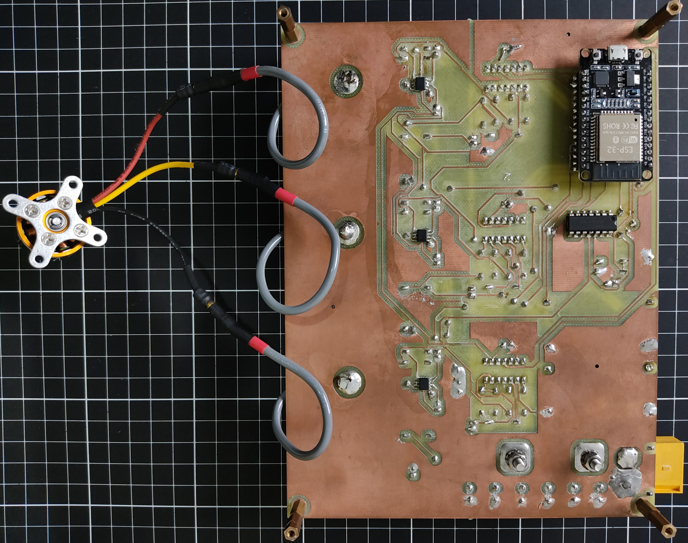

# ESP32 BLDC Electronic Speed Controller

I graduated in **Electrical Engineering at UNESP/FEIS in August 2026**. For my final degree project, I developed and analyzed a three-phase BLDC controller prototype, combining power electronics, PCB design, simulation and embedded firmware.

[My published thesis — UNESP](https://hdl.handle.net/11449/327581) · [Firmware guide](Firmware/DOCUMENTACAO_PROGRAMACAO.md) · [Schematics and PCB](Hardware/PCB_Project) · [Thesis results](Docs/Thesis/capitulos/5_conclusao.tex)



*Prototype assembled for my thesis.*

## What I developed

I worked on the power-stage and PCB design in Altium, LTspice simulations, C/C++ firmware integration, static bench testing and fault investigation. I documented the methods, observations and results in my thesis.

| Area | Implementation and artifacts |
| --- | --- |
| Hardware | Altium schematics, PCB layout, fabrication outputs and prototype photographs in [Hardware/PCB_Project/](Hardware/PCB_Project/) |
| Simulation | LTspice circuits and exported waveform data in [Simulation/](Simulation/) |
| Data analysis | [ScriptPlots.m](Simulation/ScriptPlots.m) imports LTspice output and exports MATLAB plots |
| Firmware | C control/drivers/HAL and a C++ application; six-step commutation, PI routines, a state machine, ADC acquisition and protection logic |
| Interfaces | Serial HMI, optional PS4/Bluetooth commands, and serial/optional Wi-Fi telemetry |

## Architecture

I organized the firmware around application, input, control, driver and hardware abstraction modules.

| Layer | Responsibility | Entry point |
| --- | --- |
| Application | Startup, operating states, command routing and telemetry | [main.cpp](Firmware/src/main.cpp), [fsm_system.c](Firmware/src/fsm_system.c) |
| Input | Serial HMI and optional PS4/Bluetooth input | [input modules](Firmware/lib/input/) |
| Control | Six-step commutation and PI routines, with FreeRTOS task infrastructure | [motor_control.c](Firmware/lib/control/motor_control.c) |
| Drivers | Phase-current sensing, battery monitoring and protection interfaces | [drivers](Firmware/lib/drivers/) |
| Hardware abstraction | MCPWM, ADC1, GPIO and DAC access through ESP-IDF APIs | [HAL](Firmware/lib/hal/) |

I used **Arduino within PlatformIO**, alongside native ESP-IDF APIs and FreeRTOS. The configuration and pin mapping are in [platformio.ini](Firmware/platformio.ini), [board_config.h](Firmware/include/board_config.h) and [ESP32_PINMAP.md](Hardware/PCB_Project/ESP32_PINMAP.md).

Serial HMI and optional PS4 input provide commands; serial and optional Wi-Fi provide telemetry. Configuration flags determine which interfaces are active.

## Results and next steps

I produced the hardware design files, assembled the prototype, integrated the firmware and carried out static physical bench tests, including fault investigation. My [thesis](https://hdl.handle.net/11449/327581) records the results and the [conclusion](Docs/Thesis/capitulos/5_conclusao.tex) explains the next design iteration.

**Validation scope:** my physical results cover static bench tests. Full dynamic validation with a rotating motor remains incomplete because of limitations identified in the power stage. Design targets and simulated waveforms should be read in that context.

My next technical steps are a power-stage revision and further sensorless validation. FOC and CAN are future developments; the current implementation uses six-step commutation.

## Local build procedure

Install Git and PlatformIO Core, or VS Code with the PlatformIO extension:

```sh
git clone https://github.com/enzolfernandes/esp32-bldc-esc.git
cd esp32-bldc-esc/Firmware
pio run -e esp32doit-devkit-v1
```

The checked-in configuration specifies:

- Board: `esp32doit-devkit-v1`; framework: `arduino`.
- Platform: `espressif32@6.10.0`.
- Arduino/Bluepad32 framework package pinned to commit `e010351b2cafe3a872f18878cb2d3e08f167c650`.
- ESPAsyncWebServer-esphome and AsyncTCP-esphome dependency ranges in `lib_deps`.

This procedure was documented from the repository configuration; I did not reproduce a build during the October 2026 presentation review. Record resolved dependency versions and the build log when reproducing it. For hardware commissioning, consult the thesis and firmware guide.

To process the stored simulation data, open MATLAB in `Simulation/` and run `ScriptPlots.m`. It reads `trifasico.txt` and writes figures to `plot_simulacao/`.

## Repository guide

| Directory | Contents |
| --- | --- |
| [Docs/Thesis/](Docs/Thesis/) | My LaTeX thesis source and figures |
| [Hardware/PCB_Project/](Hardware/PCB_Project/) | Altium design files and fabrication outputs |
| [Simulation/](Simulation/) | LTspice circuits, exported data and the MATLAB plotting script |
| [Firmware/](Firmware/) | ESP32 source, configuration and programming documentation |

## Sources and attribution

- [Institutional thesis record](https://repositorio.unesp.br/entities/publication/047e3b2b-8462-4287-8a9b-e9088d2abdaf).
- [Technical baseline before the presentation revisions](https://github.com/enzolfernandes/esp32-bldc-esc/tree/1c9bcb96cc0133639c62de5d59716d5ba15e6c02).
- [Six-step revision in the project history](https://github.com/enzolfernandes/esp32-bldc-esc/commit/47ea7e2c07447b11022af4c07b100056b5089129).

I used third-party frameworks and libraries, including Arduino-ESP32, ESP-IDF, FreeRTOS, Bluepad32 and networking dependencies. Their authorship and applicable notices remain with their maintainers. The repository has no root LICENSE file; this documentation assigns no new license.

*Presentation updated on 17 October 2026. Documentation changes only.*
